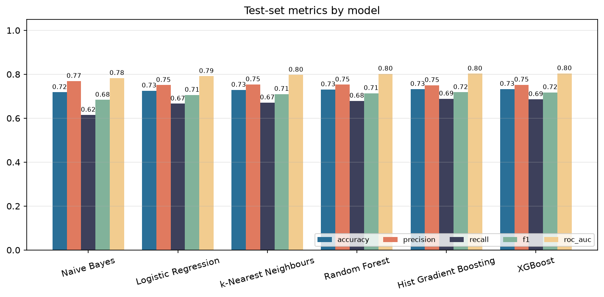
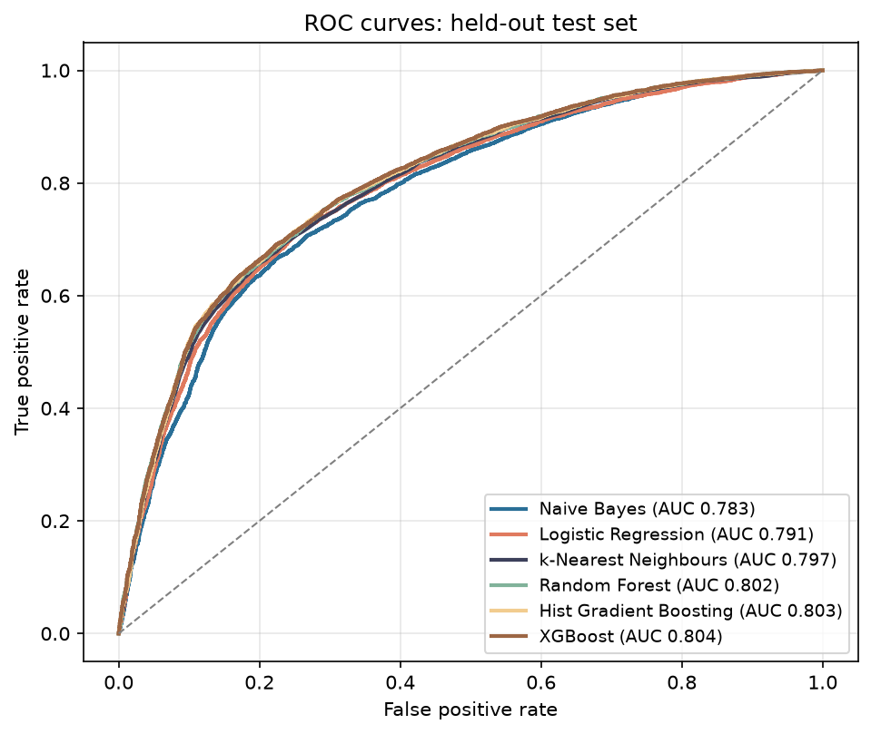
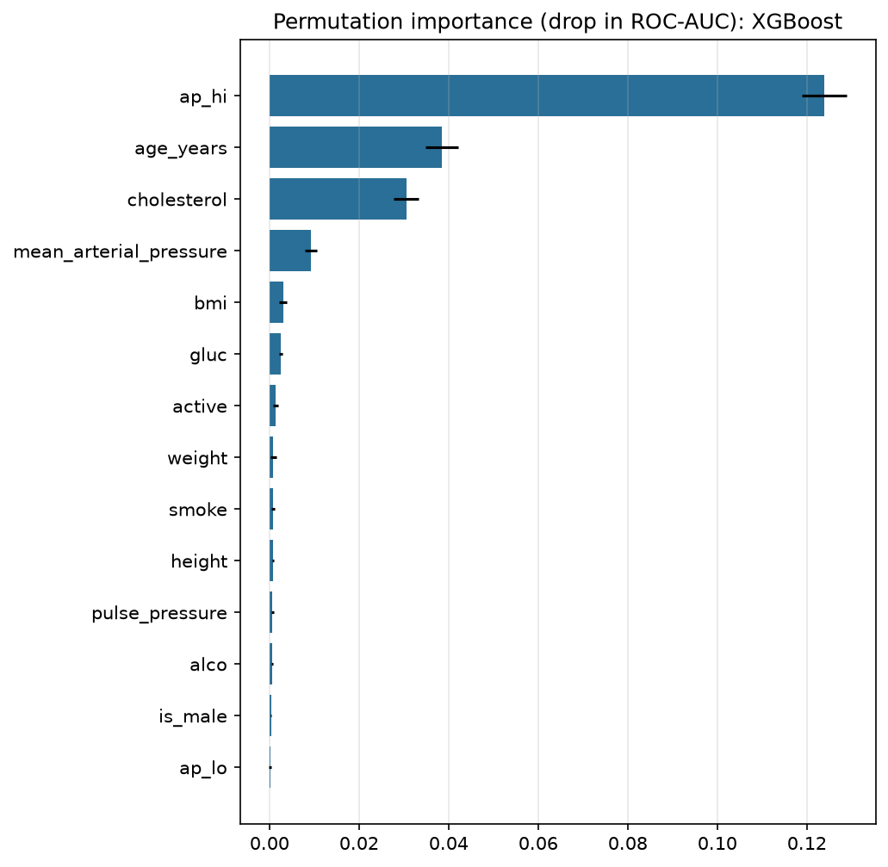
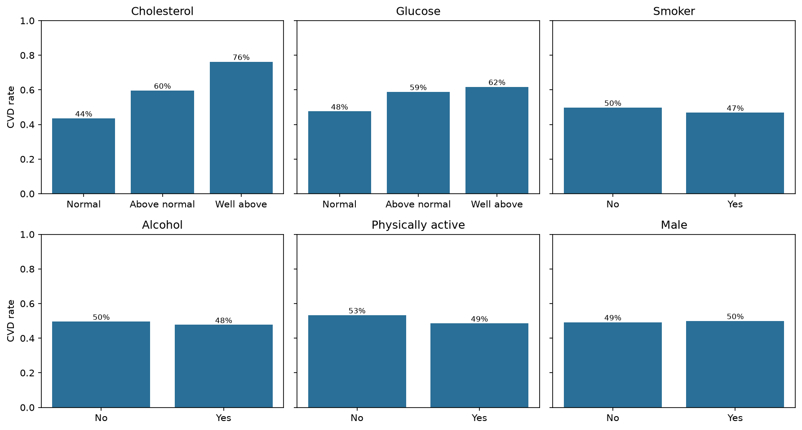
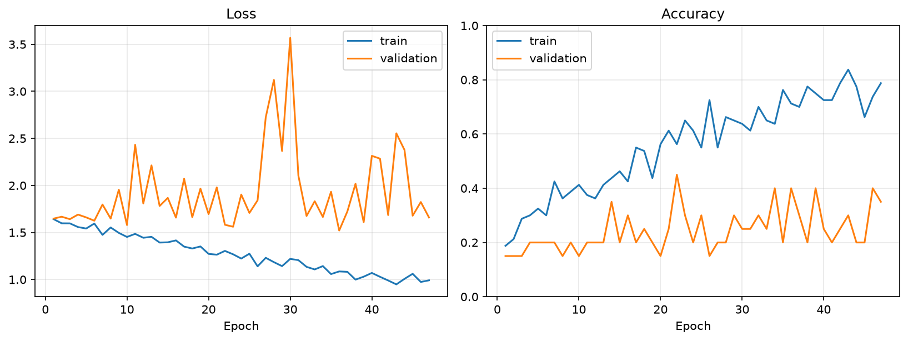
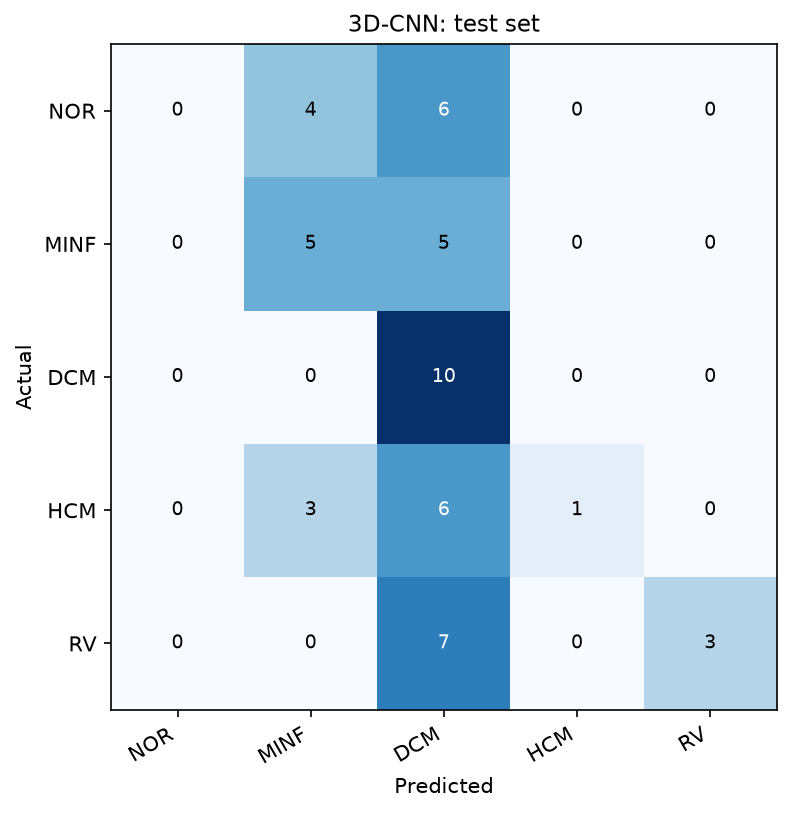
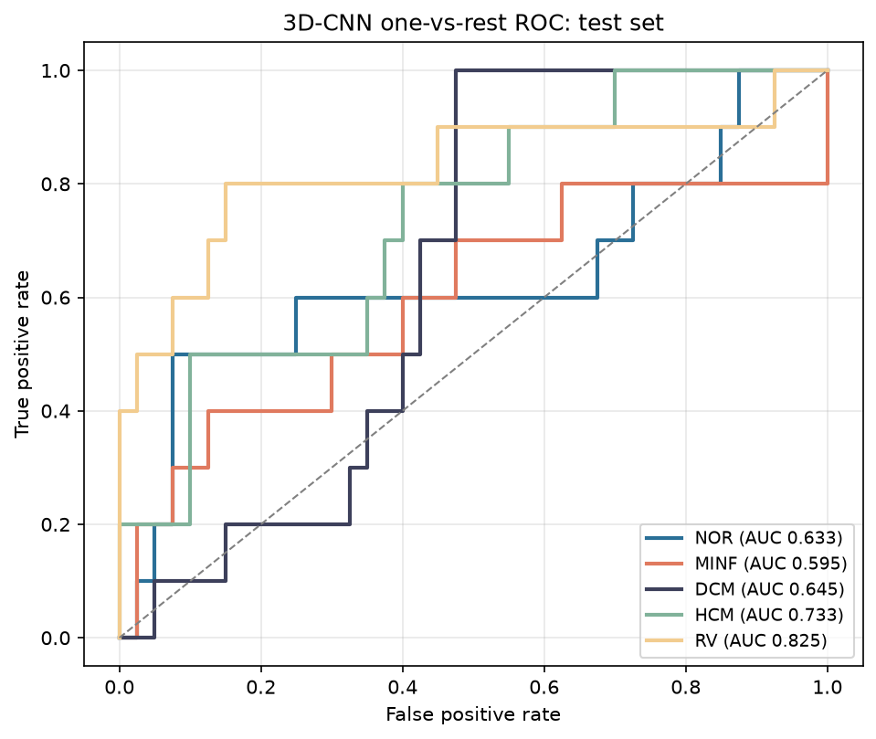

# Early Cardiac Disease Prediction: Clinical ML + Cardiac MRI

[](https://github.com/adnansyed25/Early-Cardiac-Disease-Prediction/actions/workflows/ci.yml)

Predicting cardiovascular disease (CVD) from two complementary sources:

| Modality | Data | Task | Approach |
|---|---|---|---|
| **Clinical records** | 70,000 patients, 11 routine measurements | CVD yes / no | Tuned classical ML (6 models incl. XGBoost), SHAP / permutation importance |
| **Cardiac MRI** | ACDC challenge, 150 patients, ED + ES cine-MRI | 5 diagnoses | 3D-CNN on volumes + interpretable baseline on heart metrics from segmentations |

> **Authors: Group 5.** Sidhvina Reddy, Adnan Syed, Yashvi Patel,
> Hriday Chauhan and Charan Balaji.
> The project report is in [`docs/original/`](docs/original/). This is version 2 of the
> project; see [What's new in v2](#whats-new-in-v2).

---

## Results: clinical data

Stratified 80/20 split (54,848 train / 13,713 test). Every model was tuned with randomised
search and 5-fold cross-validation on the training set only, then evaluated **once** on the test set.

| Model | CV ROC-AUC | Test accuracy | Precision | Recall | F1 | **Test ROC-AUC** |
|---|---|---|---|---|---|---|
| **XGBoost** | **0.802** | **0.733** | 0.752 | 0.686 | 0.718 | **0.804** |
| Hist Gradient Boosting | 0.801 | 0.733 | 0.750 | 0.689 | 0.718 | 0.803 |
| Random Forest | 0.800 | 0.731 | 0.753 | 0.679 | 0.714 | 0.802 |
| k-Nearest Neighbours | 0.796 | 0.729 | 0.754 | 0.671 | 0.710 | 0.797 |
| Logistic Regression | 0.791 | 0.725 | 0.751 | 0.666 | 0.706 | 0.791 |
| Naive Bayes | 0.784 | 0.718 | 0.769 | 0.615 | 0.684 | 0.783 |

**XGBoost** is the best model by cross-validation, but the top three are within 0.002 ROC-AUC
of each other, which is effectively a tie. About 73% accuracy / 0.80 ROC-AUC is close to the
ceiling usually reported for this dataset. The labels are noisy and the features are coarse
(e.g. cholesterol is only 1/2/3), so claims of 85–90%+ on it usually point to data leakage.
Train accuracy (0.744) and test accuracy (0.733) are within about 1 point, so the models are
not overfitting.

**Most important features** (permutation importance, XGBoost): systolic blood pressure
by a wide margin, then age, cholesterol, mean arterial pressure and BMI.

<p>


</p>
<p>


</p>

XGBoost and SHAP are installed from `requirements.txt`. If either is missing, the pipeline
still runs the other models and skips the SHAP plot.

## Results: cardiac MRI

Five-class diagnosis (Normal, MINF, DCM, HCM, abnormal RV) on the ACDC dataset. Chance level is 20%.

| Approach | Input | Evaluation | Accuracy |
|---|---|---|---|
| **Heart-metrics baseline: Logistic Regression** | 12 measurements from the segmentation masks (LV/RV volumes, ejection fractions, myocardial mass, BSA-indexed) | 5-fold CV, 150 patients | **93.3%** |
| Heart-metrics baseline: Random Forest | same | 5-fold CV, 150 patients | 88.7% |
| 3D-CNN | raw ED + ES volumes (2 × 8 × 128 × 128) | held-out test set, 50 patients | 38.0% |

**What this shows.** The diseases in ACDC are *defined* by these heart measurements (for example,
DCM means a dilated LV with low ejection fraction), so a simple linear model on them is very
accurate. The 3D-CNN has to learn the same information from raw pixels using only about 80
training patients. It overfits (train accuracy ~80% vs validation ~20–45%) and leans heavily
towards predicting DCM: it classified all 10 DCM cases correctly but 0 of 10 normal hearts.
With this little data, clinically meaningful features clearly beat end-to-end deep learning.

**Caveats.**
- The baseline uses the expert ground-truth segmentations, so its score is an upper bound.
  In practice the masks would come from a segmentation model.
- The two rows are evaluated differently: cross-validation over all 150 patients for the
  baseline, a fixed 50-patient test set for the CNN.
- Version 1 of this project reported 76.6% for the 3D-CNN, but that notebook had no saved
  outputs and could not run as written, so the figure could not be reproduced.

<p>

</p>
<p>


</p>

**Next steps for the CNN:** crop a region of interest around the heart before resizing (the
heart currently fills only a small part of each image), feed the segmentation masks as extra
input channels, and use a smaller network to reduce overfitting.

---

## Quick start

```bash
git clone https://github.com/adnansyed25/Early-Cardiac-Disease-Prediction.git
cd Early-Cardiac-Disease-Prediction
python -m venv .venv
# Windows: .venv\Scripts\activate    macOS/Linux: source .venv/bin/activate
pip install -r requirements.txt
pip install -e .

pytest                                     # run the tests (~30 s)
python -m cardiac.tabular.eda              # EDA figures -> reports/figures/
python -m cardiac.tabular.train --quick    # 10-second smoke run
python -m cardiac.tabular.train            # full tuned run (~10 min on a laptop)
```

### MRI pipeline

```bash
pip install -r requirements-mri.txt        # PyTorch, nibabel, huggingface_hub
# download ACDC into data/acdc/ (see data/README.md, or run notebook 03), then:
python -m cardiac.mri.preprocess           # NIfTI -> data/processed/*.npz + heart metrics
python -m cardiac.mri.metrics_baseline     # interpretable baseline
python -m cardiac.mri.train --epochs 100   # 3D-CNN (uses GPU if available)
```

Every script has `--help`. The notebooks in [`notebooks/`](notebooks/) call the same code
for interactive use.

## Project structure

```
├── data/
│   ├── raw/cardiovascular.csv        # clinical dataset (included)
│   └── README.md                     # data dictionary + how to get ACDC
├── src/cardiac/
│   ├── config.py                     # paths, feature lists, class order (single source of truth)
│   ├── plots.py
│   ├── tabular/
│   │   ├── data.py                   # loading, cleaning, feature engineering
│   │   ├── models.py                 # model registry + search spaces (sklearn Pipelines)
│   │   ├── train.py                  # CV tuning, evaluation, reports
│   │   ├── explain.py                # permutation importance + SHAP
│   │   └── eda.py
│   └── mri/
│       ├── preprocess.py             # NIfTI -> arrays, heart metrics from masks
│       ├── dataset.py                # PyTorch dataset + augmentation
│       ├── model.py                  # 3D-CNN
│       ├── train.py                  # training loop, early stopping, evaluation
│       └── metrics_baseline.py       # classifier on segmentation-derived metrics
├── notebooks/                        # 01 EDA · 02 clinical models · 03 MRI
├── reports/                          # generated tables + figures
├── tests/                            # pytest suite (runs in GitHub Actions)
└── docs/original/                    # project report (v1)
```

## What's new in v2

Version 1 was a set of Colab notebooks. Version 2 turns it into a tested Python package.

**Bugs fixed**
- `3D_CNN.ipynb` had a syntax error (`lr=3e-,`) and read keys (`ED`, `ES`, `Label`) that the
  preprocessing step never wrote (`ED_VOL`, `ES_VOL`, `Group`), so the two notebooks could not run together.
- The MRI reports printed class names in a different order from the label map
  (`NOR, MINF, DCM, HCM, RV` vs `Normal, DCM, HCM, MINF, ARV`), which mislabelled the per-class
  results. Class order now comes from one constant in `config.py`.
- `CosineAnnealingLR.step(val_loss)` passed the loss as an epoch number. It is now stepped once per epoch.
- `LabelEncoder` ordered cholesterol/glucose alphabetically ("extremely high" → 0 < "normal" → 2).
  These features now keep their natural 1 < 2 < 3 order.
- The scaler was fitted on the full dataset before splitting (test-set leakage). Scaling now
  lives inside each model's `Pipeline`.
- The README reported 88% accuracy for XGBoost, but the notebook's own output was about 73%.
  All numbers here are produced by the code in this repo.
- Hard-coded Google Colab / Windows paths were replaced with project-relative paths.

**Improvements**
- Stricter, documented data cleaning (physiological ranges, duplicates, diastolic ≥ systolic).
- New features: pulse pressure and mean arterial pressure.
- New models: Random Forest and Histogram Gradient Boosting, alongside a tuned XGBoost.
- Hyper-parameter tuning with stratified cross-validation, and ROC-AUC alongside accuracy.
- Model selection by CV score, never by test score.
- Explainability: permutation importance and SHAP.
- MRI: stratified validation split, augmentation, early stopping with best-checkpoint restore,
  per-volume normalisation, in-plane pooling suited to 8-slice volumes, and ROC on the test set.
- Heart-metrics baseline (the "feature extraction from segmentation masks" idea from v1's future work).
- Reusable package, CLI scripts, unit tests and GitHub Actions CI.

## Limitations

- The clinical dataset is from a single source with self-reported lifestyle fields. Results
  may not transfer to other populations.
- ACDC is small (100 labelled training patients), so CNN results vary noticeably between runs.
- This is a research and learning project, **not** a medical device.
